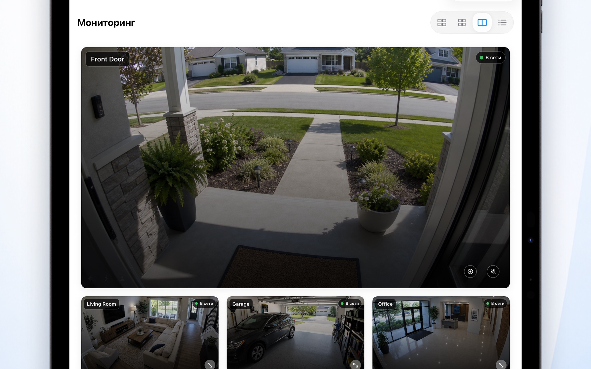
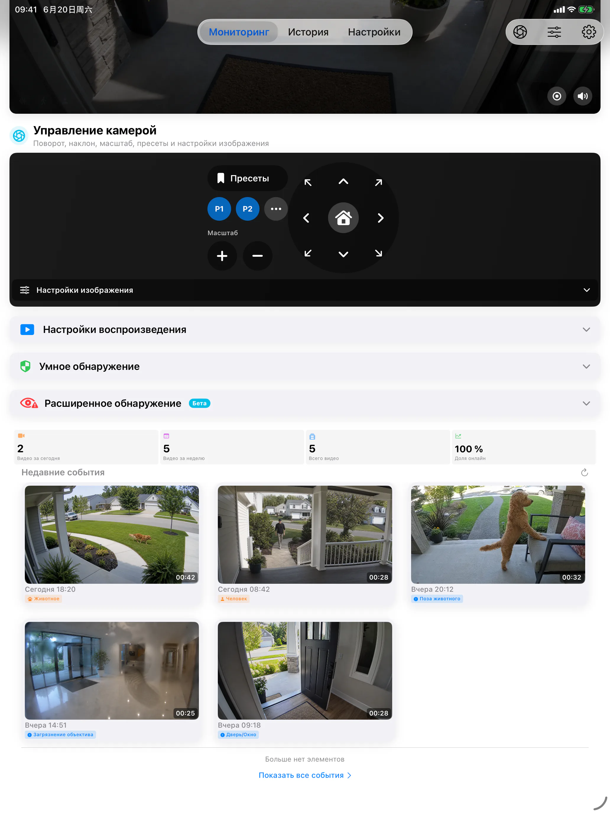

# SmartRTSP для iPad — Просмотр нескольких камер RTSP и ONVIF

Используйте iPad как удобный экран для камер. SmartRTSP объединяет совместимые камеры RTSP и ONVIF, чтобы вы могли лучше следить за домом, зоной приёма посетителей или небольшим бизнесом.

**[Скачать в App Store](https://apps.apple.com/us/app/smart-rtsp-ip-camera-viewer/id6759822092)** · [Официальный сайт](https://www.smartrtsp.com/)

**Выберите язык**

[English](./README.md) · [Deutsch](./README.de.md) · [Français](./README.fr.md) · [Español](./README.es.md) · [Italiano](./README.it.md) · [Português](./README.pt.md) · [Nederlands](./README.nl.md) · [Polski](./README.pl.md) · [Svenska](./README.sv.md) · [Suomi](./README.fi.md) · [Română](./README.ro.md) · **Русский** · [Українська](./README.uk.md) · [Türkçe](./README.tr.md)

На большом экране удобнее наблюдать за несколькими камерами, рассматривать один видеопоток и просматривать записи.

## Скриншоты приложения

## Основные возможности

- **Подключайте камеры** — Добавляйте совместимые потоки RTSP или находите камеры ONVIF в локальной сети.
- **Выбирайте вид просмотра** — Переключайтесь между отдельными камерами и раскладкой с несколькими камерами, подходящей для вашего экрана.
- **Записывайте и просматривайте** — Сохраняйте записи локально и возвращайтесь к важным моментам в истории записей.
- **Находите важные события** — Настраивайте поддерживаемые функции обнаружения движения, людей или звуков, чтобы находить моменты, которые стоит просмотреть.
- **Управляйте совместимыми камерами** — Используйте поворот, наклон и масштабирование, если камера предоставляет поддерживаемую службу ONVIF PTZ.
- **Смотрите локально** — Для локального просмотра камер не нужна учётная запись SmartRTSP. При этом могут потребоваться данные для входа в саму камеру.

## Где пригодится SmartRTSP

- **Дом и входные зоны** — Проверяйте камеры у входа, на подъездной дорожке или в других местах рядом с домом.
- **Магазины и зоны приёма посетителей** — Следите за несколькими участками небольшого магазина или зоны приёма посетителей с одного экрана.
- **Питомцы и повседневные проверки** — Откройте совместимую камеру, чтобы быстро посмотреть, что происходит рядом с питомцем или в другой комнате.

## Начало работы

1. Установите SmartRTSP по ссылке на официальный магазин ниже.
2. Подключите устройство и камеру к одной локальной сети, затем найдите камеру или добавьте поддерживаемый адрес видеопотока.
3. При необходимости введите данные для входа в камеру, откройте видео в реальном времени и выберите нужные функции просмотра или записи.

## Частые вопросы

### Какие камеры работают со SmartRTSP?

Камера или видеорегистратор должны предоставлять поддерживаемый поток RTSP или службу ONVIF. Совместимость зависит от модели, прошивки и включённых настроек. Для управления PTZ также нужна совместимая камера.

### Нужна ли учётная запись SmartRTSP?

Локальные камеры можно смотреть без учётной записи SmartRTSP. Сама камера может требовать отдельные имя пользователя и пароль.

### Включены ли все функции при скачивании?

Пробные периоды, функции Pro, доступные покупки и цены зависят от платформы. Актуальные условия указаны в приложении и на его странице в официальном магазине. Для просмотра нескольких камер, записи и обнаружения событий может потребоваться Pro.

### Где хранятся записи?

Записи сохраняются на вашем устройстве или в выбранном вами месте, если это поддерживается. Необязательные сетевые службы работают в соответствии с включёнными настройками.

## Скачать SmartRTSP

**[Скачать в App Store](https://apps.apple.com/us/app/smart-rtsp-ip-camera-viewer/id6759822092)**

## Официальные ссылки

- [Официальный сайт](https://www.smartrtsp.com/)
- [Помощь и руководства по камерам](https://www.smartrtsp.com/guides/)
- [Политика конфиденциальности](https://www.smartrtsp.com/privacy)

## Другие платформы

[iPhone](https://github.com/smartrtsp/smartrtsp-iphone/blob/main/README.ru.md) · [Apple TV](https://github.com/smartrtsp/smartrtsp-tvos/blob/main/README.ru.md) · [Телефоны и планшеты Android](https://github.com/smartrtsp/smartrtsp-android/blob/main/README.ru.md) · [Android TV и Google TV](https://github.com/smartrtsp/smartrtsp-android-tv/blob/main/README.ru.md) · [Mac](https://github.com/smartrtsp/smartrtsp-macos/blob/main/README.ru.md) · [Windows](https://github.com/smartrtsp/smartrtsp-windows/blob/main/README.ru.md)
